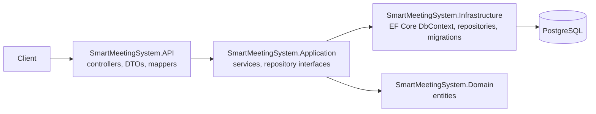

# Smart Meeting System API

ASP.NET Core 9 Web API for booking meeting rooms, managing room gadgets and recording minutes of meeting (MoM). Authentication uses ASP.NET Identity with JWT bearer tokens and `Admin` / `User` roles.

The React client lives in [smart-meeting-room-frontend](https://github.com/razanhasbini/smart-meeting-room-frontend).

## Architecture



| Resource | Route | Notes |
|---|---|---|
| Auth | `POST /api/Auth/register`, `POST /api/Auth/login`, `GET /api/Auth/me` | returns a JWT |
| Rooms | `/api/Rooms` CRUD | writes require `Admin` |
| Bookings | `/api/Bookings` CRUD | authenticated users |
| Gadgets, RoomGadgets | `/api/Gadgets`, `/api/RoomGadgets` CRUD | writes require `Admin` |
| Minutes of meeting | `/api/bookings/{bookingId}/mom` | per booking |
| Users | `/api/User` | `Admin` |

Swagger UI is available at `/swagger` in Development.

## Running locally

Requirements: .NET 9 SDK and Docker (or any local PostgreSQL).

```bash
docker compose up -d                      # local Postgres matching appsettings.Development.json
cd SmartMeetingSystem.API
dotnet user-secrets set "Jwt:Key" "$(openssl rand -hex 32)"
dotnet user-secrets set "Seed:AdminPassword" "<choose-a-password>"   # optional demo admin
dotnet user-secrets set "Seed:UserPassword"  "<choose-a-password>"   # optional demo user
dotnet run
```

Migrations are applied on startup. Demo accounts (`admin@smartmeetings.local`, `user@smartmeetings.local`) are created only in the Development environment and only when a seed password is configured.

`SmartMeetingSystem.API/SmartMeetingSystem.API.http` contains example requests for the VS Code REST Client or Rider.

## Configuration

| Key | Required | Purpose |
|---|---|---|
| `ConnectionStrings:DefaultConnection` | yes | PostgreSQL connection string (Development default points at the docker-compose database) |
| `Jwt:Key` | yes | HMAC signing key, at least 32 bytes; keep it in User Secrets or an environment variable |
| `Jwt:Issuer`, `Jwt:Audience`, `Jwt:AccessTokenMinutes` | no | token settings |
| `Seed:AdminPassword`, `Seed:UserPassword` | no | Development-only demo accounts |

In other environments, use environment variables such as `ConnectionStrings__DefaultConnection` and `Jwt__Key`. The app refuses to start if the connection string or signing key is missing.

## Known limitations

- No automated tests yet.
- There are two `TokenService` implementations (`API/Auth` and `Application/Service`); one should be removed.
- `MyJWT/` is an unused template project.
- CORS allows only `localhost:3000-3002`.
